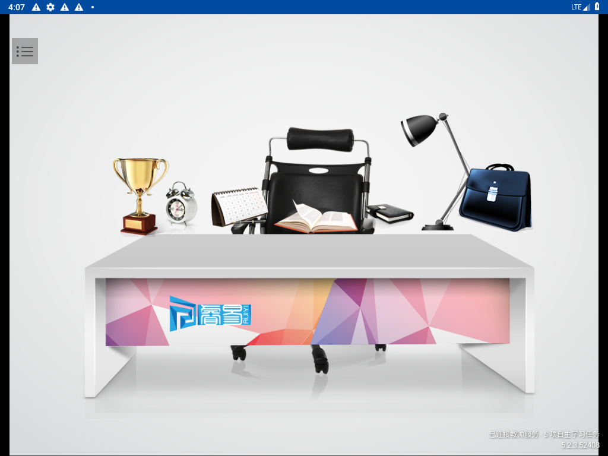
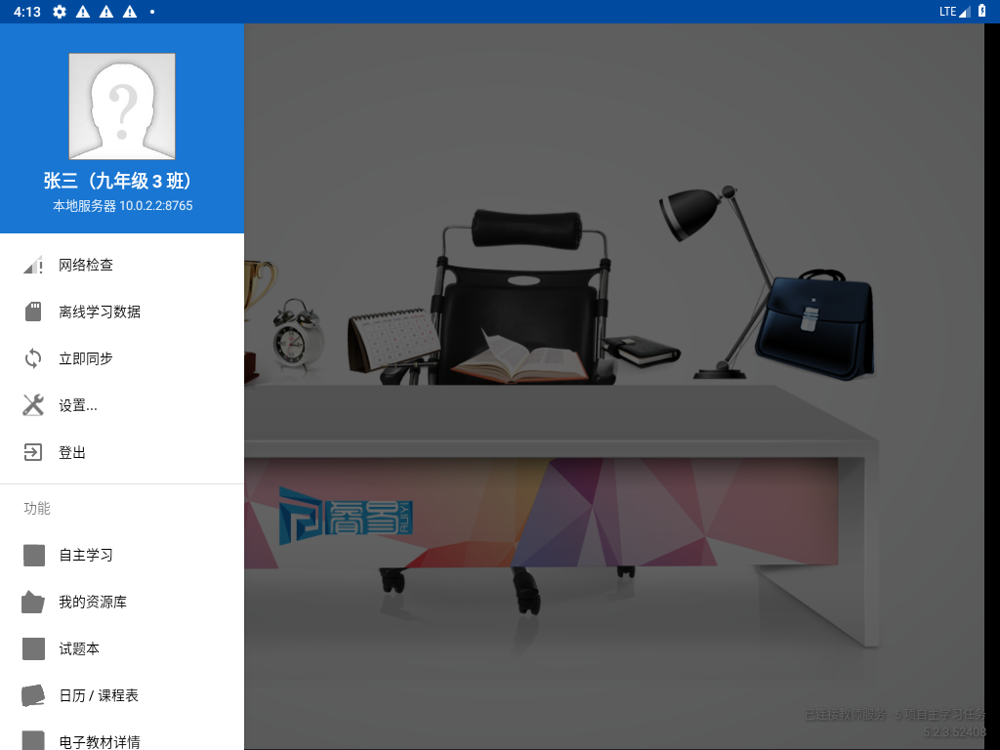
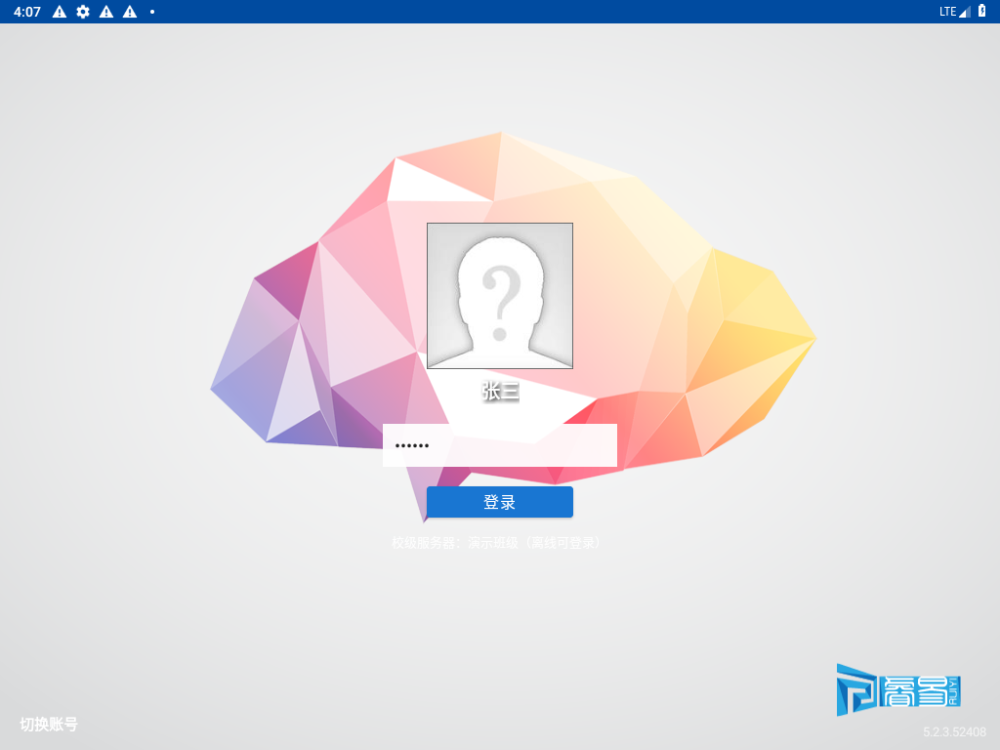
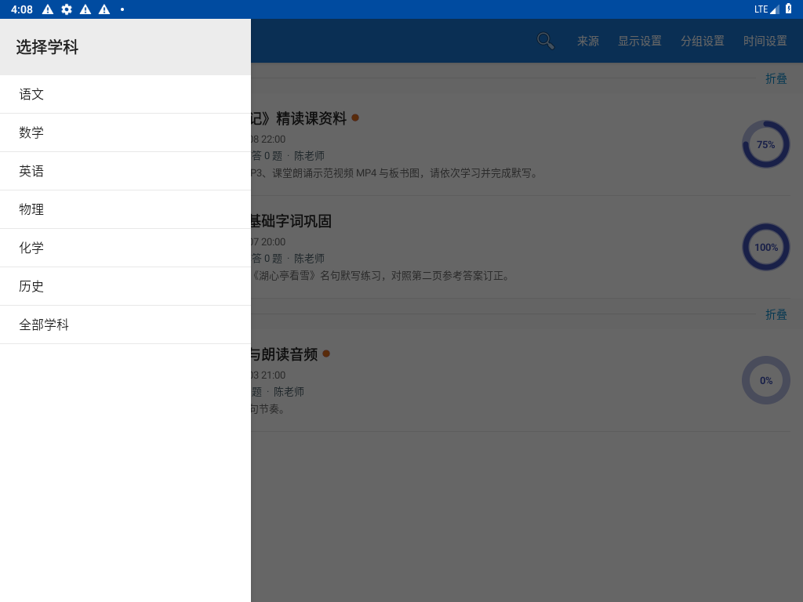
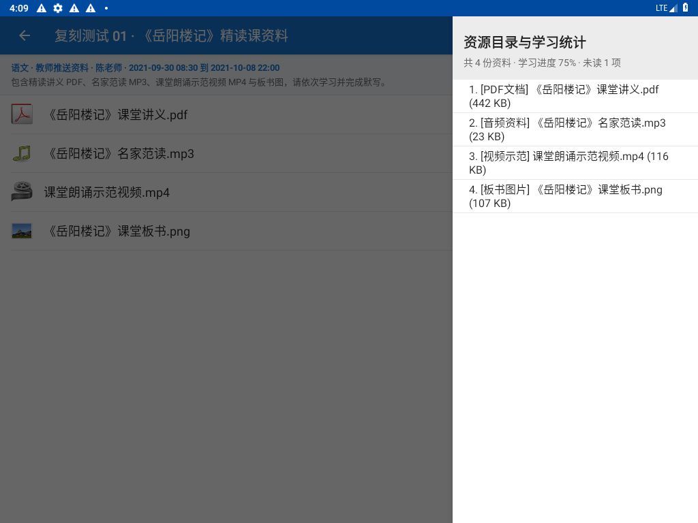
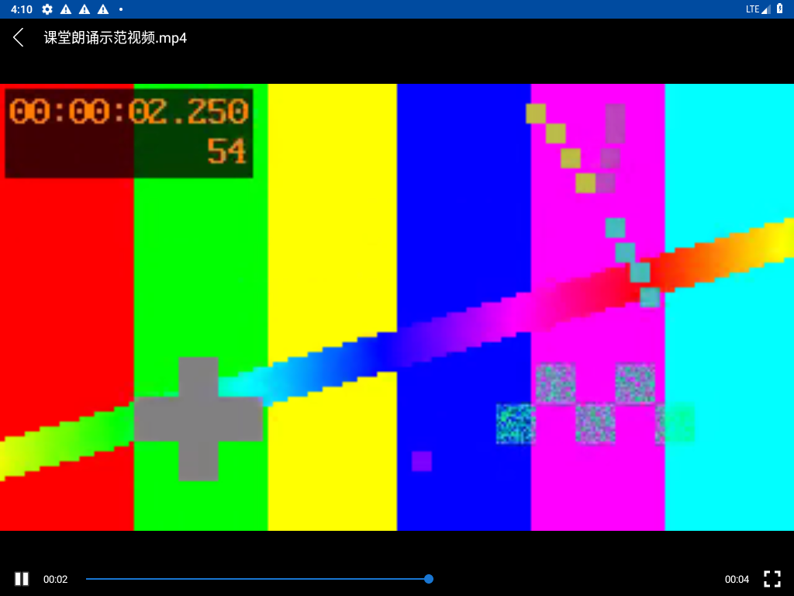
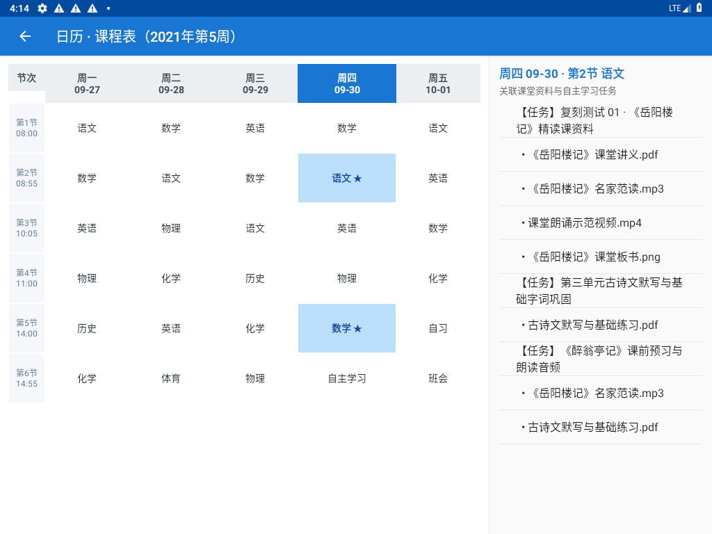
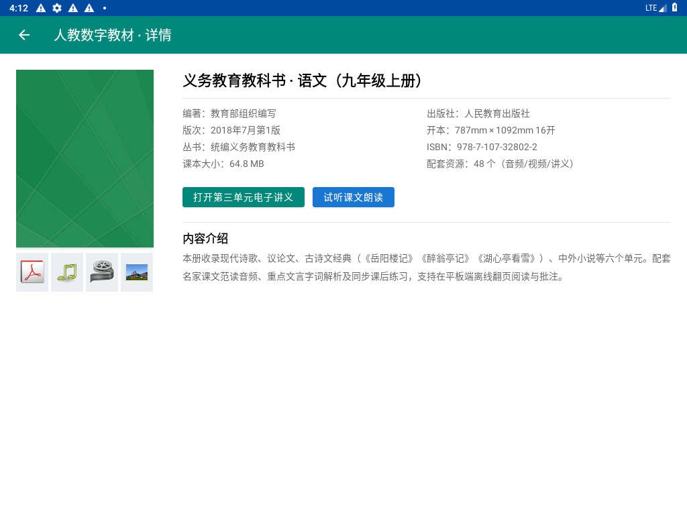
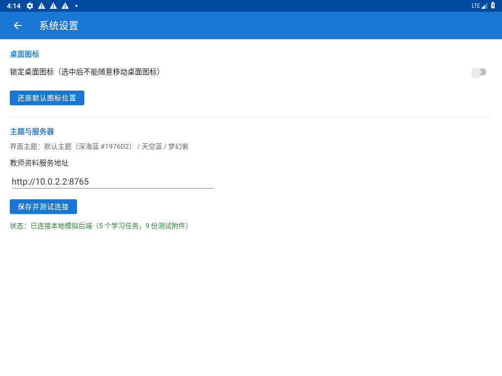

# 少年派学习平板 · 复刻版（Android 客户端 + 教师资料后端）

基于原版「少年派学习平板客户端」（`com.netspace.myipad`, `5.2.3.52408`）提取的原始 UI 资源（桌面原图、7 件桌面物品坐标、主题配色、图标及 805 份 XML 布局规格）重建的原生 Android 平板客户端与配套本地教师发资料服务。

## 目录结构

```text
.
├── android/          # 原生 Android Gradle 工程（Kotlin, minSdk 21, targetSdk 34, 适配 1024×768 mdpi 横屏）
├── backend/          # 本地教师资料发布与学生端同步服务（Starlette + SQLite，支持 Range 206）
│   ├── server.py
│   ├── generate_samples.py
│   └── sample_assets/  # 内置测试 PDF（多页中文讲义/数学抛物线/英语导学）、板书图、MP3、MP4
└── screenshots/      # Android 9 模拟器（1024×768 @ 160dpi）逐页实机渲染基准截图（18 张）
```

## 已打通的核心主链路

1. **教师端发布资料**：`POST /assets` 上传文件（返回 `assetId` / `sha256` / `mime` / `bytes`）→ `POST /deliveries` 原子发布带顺序附件的学习任务（支持 `clientRequestId` 幂等重试）。
2. **学生端桌面进入合册**：书桌主界面按 1024×768 基准等比居中映射 7 件可拖动/可锁定物品，轻触右侧合册 `ic_desktop_study`（基准坐标 `(610, 330)`，中心 `(657, 353)`）进入「自主学习」。
3. **自主学习学科任务列表**：支持左侧学科抽屉切换、顶栏筛选菜单、日期分组折叠、2×2 附件类型拼图缩略图、64dp 圆环进度条、列表/网格双视图切换。
4. **任务详情与多格式媒体打开**：
   - 富卡片模式（`layout_resourceitem2`）：内嵌 PDF 首页实时缩略图、可播放 MP3 音频条（`#BB000000` + `MediaPlayer`）、MP4 视频封面（80dp 播放钮）、高清课堂板书图。
   - 紧凑文件行模式（`listitem_resourcelist`）+ 右侧「资源目录与学习统计」抽屉。
   - **PDF 阅读器**：Android 原生 `PdfRenderer` 渲染多页中文讲义，支持上一页/下一页、页码持久化与顶栏阅读进度条。
   - **全屏视频播放器**：原生 `VideoView` 播放样本 MP4，带标准顶栏与底部拖动进度条。
5. **扩展教学模块**：登录页、我的资源库、分栏试题本（错题与解析）、周课程表日历、人教数字教材详情、系统设置（图标锁定/坐标还原/后端地址配置）。

## 快速启动

### 1. 启动本地教师资料服务

```bash
cd backend
python3 -m pip install -r requirements.txt
python3 generate_samples.py
python3 server.py --host 0.0.0.0 --port 8765
```

浏览器打开 `http://127.0.0.1:8765` 可查看教师端任务清单，Android 模拟器默认通过 `http://10.0.2.2:8765` 拉取数据（断网时自动回退至 APK 内置的离线测试资源）。

### 2. 编译安装 Android 客户端

```bash
cd android
gradle assembleDebug
adb install -r -g app/build/outputs/apk/debug/app-debug.apk
```

## 模拟器实机渲染基准截图（Android 9 · 1024×768 · 160dpi）

| 序号 | 页面 | 对应原包布局 | 截图 |
| --- | --- | --- | --- |
| 01 | 书桌主界面（7 件物品原坐标） | `activity_desktop.xml` |  |
| 02 | 书桌左侧 250dp 功能抽屉 | `activity_desktop.xml` + `drawer_header.xml` |  |
| 03 | 登录界面 | `activity_login2.xml` |  |
| 04 | 自主学习 · 语文（列表视图） | `activity_selflearnview.xml` + `layout_customselflearnitemview2_list.xml` |  |
| 05 | 自主学习 · 学科切换抽屉 | `activity_selflearnview.xml` |  |
| 06 | 自主学习 · 全部学科网格视图 | `layout_customselflearnitemview2_grid.xml` |  |
| 07 | 自主学习 · 数学 | `activity_selflearnview.xml` |  |
| 08 | 任务详情 · 富卡片（PDF/MP3/MP4） | `activity_resourcesview2.xml` + `layout_resourceitem2.xml` |  |
| 09 | 任务详情 · 滚动查看音视频与板书 | `layout_customaudioview.xml` + `layout_customvideoplayerwrapper.xml` |  |
| 10 | 任务详情 · 紧凑文件行 + 统计抽屉 | `listitem_resourcelist.xml` + `layout_resourcestatistic.xml` |  |
| 11 | PDF 阅读器 · 第 1 页 | `activity_documentview.xml` |  |
| 12 | PDF 阅读器 · 第 2 页 | `activity_documentview.xml` |  |
| 13 | 全屏视频播放器 | `activity_videoplayer2.xml` + `video_layout_standard.xml` |  |
| 14 | 我的资源库 | `fragment_myilibrary.xml` + `listitem_resourcelist.xml` |  |
| 15 | 试题本（分栏错题解析） | `activity_questionbook.xml` |  |
| 16 | 日历 / 课程表 | `activity_scheduleview.xml` |  |
| 17 | 人教数字教材详情 | `act_book_detail_pep.xml` |  |
| 18 | 系统设置 | `settings_ui.xml` |  |
