# 少年派学习平板 · 复刻版（Android 客户端 + 教师资料后端）

基于原版「少年派学习平板客户端」（`com.netspace.myipad`, `5.2.3.52408`）提取的原始 UI 资源（桌面原图、7 件桌面物品坐标、主题配色、图标及 805 份 XML 布局规格）重建的原生 Android 平板客户端与配套本地教师发资料服务。

## 目录结构

```text
.
├── android/          # 原生 Android Gradle 工程（Kotlin, minSdk 21, targetSdk 34, 适配 1024×768 mdpi 横屏）
├── backend/          # 本地教师资料发布与学生端同步服务（Starlette + SQLite，支持 Range 206）
│   ├── server.py
│   ├── generate_samples.py
│   └── sample_assets/  # 内置测试 PDF（多页中文讲义/数学抛物线/英语导学）、板书图、MP3、MP4
└── screenshots/      # Android 9 模拟器（1024×768 @ 160dpi）逐页实机渲染基准截图（18 张）
```

## 已打通的核心主链路

1. **教师端发布资料**：`POST /assets` 上传文件（返回 `assetId` / `sha256` / `mime` / `bytes`）→ `POST /deliveries` 原子发布带顺序附件的学习任务（支持 `clientRequestId` 幂等重试）。
2. **学生端桌面进入合册**：书桌主界面按 1024×768 基准等比居中映射 7 件可拖动/可锁定物品，轻触右侧合册 `ic_desktop_study`（基准坐标 `(610, 330)`，中心 `(657, 353)`）进入「自主学习」。
3. **自主学习学科任务列表**：支持左侧学科抽屉切换、顶栏筛选菜单、日期分组折叠、2×2 附件类型拼图缩略图、64dp 圆环进度条、列表/网格双视图切换。
4. **任务详情与多格式媒体打开**：
   - 富卡片模式（`layout_resourceitem2`）：内嵌 PDF 首页实时缩略图、可播放 MP3 音频条（`#BB000000` + `MediaPlayer`）、MP4 视频封面（80dp 播放钮）、高清课堂板书图。
   - 紧凑文件行模式（`listitem_resourcelist`）+ 右侧「资源目录与学习统计」抽屉。
   - **PDF 阅读器**：Android 原生 `PdfRenderer` 渲染多页中文讲义，支持上一页/下一页、页码持久化与顶栏阅读进度条。
   - **全屏视频播放器**：原生 `VideoView` 播放样本 MP4，带标准顶栏与底部拖动进度条。
5. **扩展教学模块**：登录页、我的资源库、分栏试题本（错题与解析）、周课程表日历、人教数字教材详情、系统设置（图标锁定/坐标还原/后端地址配置）。

## 快速启动

### 1. 启动本地教师资料服务

```bash
cd backend
python3 -m pip install -r requirements.txt
python3 generate_samples.py
python3 server.py --host 0.0.0.0 --port 8765
```

浏览器打开 `http://127.0.0.1:8765` 可查看教师端任务清单，Android 模拟器默认通过 `http://10.0.2.2:8765` 拉取数据（断网时自动回退至 APK 内置的离线测试资源）。

### 2. 编译安装 Android 客户端

```bash
cd android
gradle assembleDebug
adb install -r -g app/build/outputs/apk/debug/app-debug.apk
```

### 3. 自动递增发布（`v0.1.n+1`）与固定正式签名

仓库已配置 [`.github/workflows/release.yml`](.github/workflows/release.yml) 与固定的 Android 发布签名密钥（密钥存放在 GitHub Actions Secrets：`KEYSTORE_BASE64` / `KEYSTORE_PASSWORD` / `KEY_ALIAS` / `KEY_PASSWORD`，证书 SHA-256 指纹：`5E:69:B2:E9:EC:27:1C:E5:5A:4A:82:E2:06:05:DD:10:D6:2F:62:C1:0A:58:D3:9B:DF:40:18:EB:D3:3E:B0:37`）。

- **一键递增发布（推荐）**：在 GitHub 仓库 **Actions → Build & Publish Android Release → Run workflow**，版本号留空点击运行，CI 会自动读取最新 `v0.1.n` 标签，递增为 `v0.1.(n+1)`、打 Tag、使用固定正式密钥签名打包并发布 GitHub Release。
- **推送标签发布**：也可在本地直接 `git tag -a v0.1.n -m "Release v0.1.n" && git push origin v0.1.n` 触发自动构建与发布。
- **无缝应用内升级**：从 `v0.1.1` 起均使用同一正式密钥签名，后续 `v0.1.2`、`v0.1.3` ... 可在 App「设置 → 检查并安装更新」中直接免卸载覆盖安装（从早期调试签名的 `v0.1.0` 升级到 `v0.1.1` 时需先卸载一次旧版）。

## 模拟器实机渲染基准截图（Android 9 · 1024×768 · 160dpi）

| 序号 | 页面 | 对应原包布局 | 截图 |
| --- | --- | --- | --- |
| 01 | 书桌主界面（7 件物品原坐标） | `activity_desktop.xml` |  |
| 02 | 书桌左侧 250dp 功能抽屉 | `activity_desktop.xml` + `drawer_header.xml` |  |
| 03 | 登录界面 | `activity_login2.xml` |  |
| 04 | 自主学习 · 语文（列表视图） | `activity_selflearnview.xml` + `layout_customselflearnitemview2_list.xml` |  |
| 05 | 自主学习 · 学科切换抽屉 | `activity_selflearnview.xml` |  |
| 06 | 自主学习 · 全部学科网格视图 | `layout_customselflearnitemview2_grid.xml` | 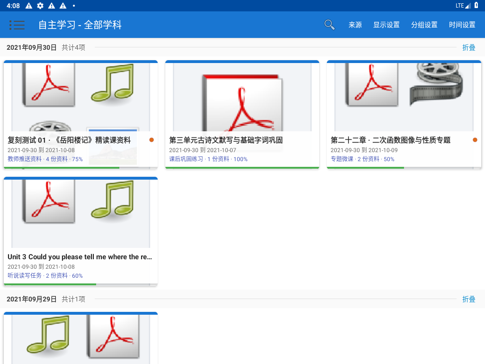 |
| 07 | 自主学习 · 数学 | `activity_selflearnview.xml` |  |
| 08 | 任务详情 · 富卡片（PDF/MP3/MP4） | `activity_resourcesview2.xml` + `layout_resourceitem2.xml` | 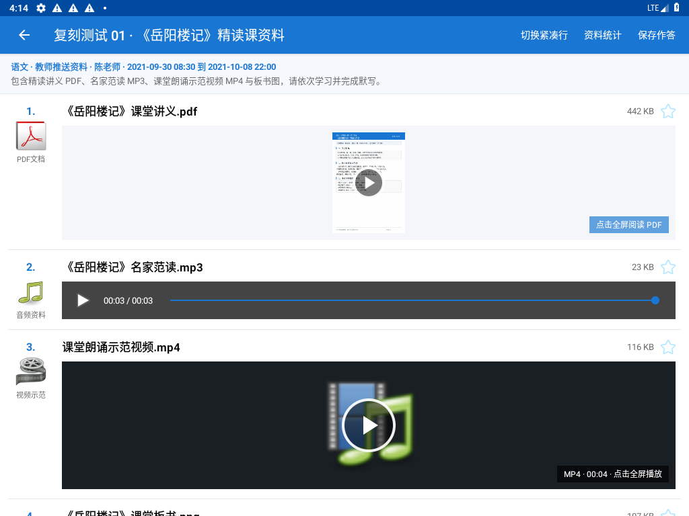 |
| 09 | 任务详情 · 滚动查看音视频与板书 | `layout_customaudioview.xml` + `layout_customvideoplayerwrapper.xml` | 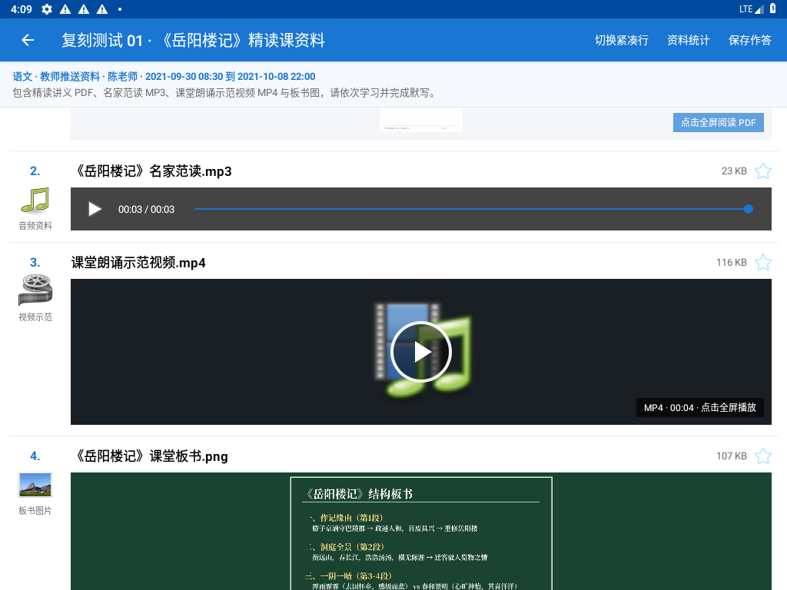 |
| 10 | 任务详情 · 紧凑文件行 + 统计抽屉 | `listitem_resourcelist.xml` + `layout_resourcestatistic.xml` |  |
| 11 | PDF 阅读器 · 第 1 页 | `activity_documentview.xml` |  |
| 12 | PDF 阅读器 · 第 2 页 | `activity_documentview.xml` |  |
| 13 | 全屏视频播放器 | `activity_videoplayer2.xml` + `video_layout_standard.xml` |  |
| 14 | 我的资源库 | `fragment_myilibrary.xml` + `listitem_resourcelist.xml` | 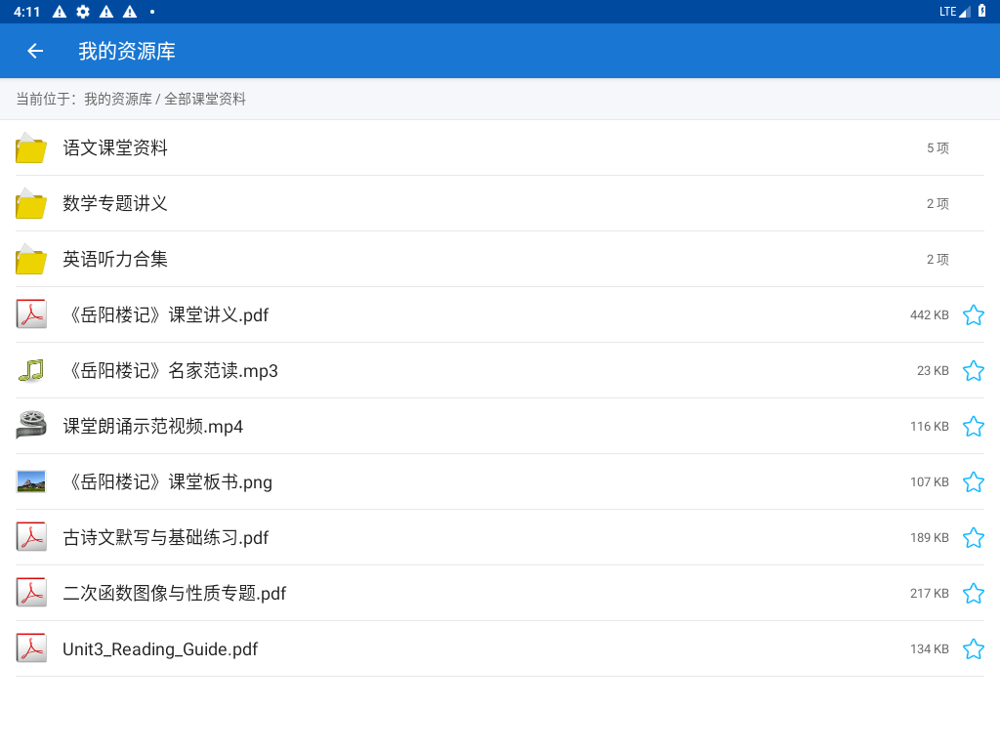 |
| 15 | 试题本（分栏错题解析） | `activity_questionbook.xml` | 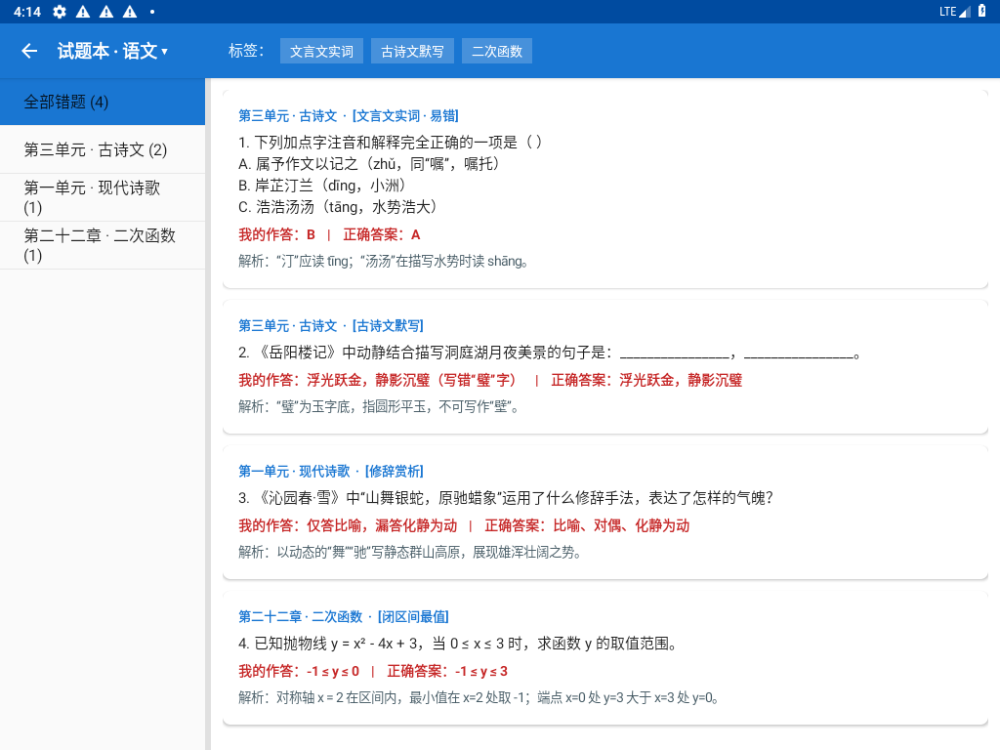 |
| 16 | 日历 / 课程表 | `activity_scheduleview.xml` |  |
| 17 | 人教数字教材详情 | `act_book_detail_pep.xml` |  |
| 18 | 系统设置（含 GitHub 自动检查更新） | `settings_ui.xml` |  |

### 竖屏手机适配基准截图（412×892dp）

- 支持平板横屏与手机竖屏自由旋转；竖屏书桌顶部保留 7 件可点物品，下方提供 2 列快捷入口卡片；自主学习列表、任务详情、试题本、课程表、数字教材与设置页均已做窄屏响应式重排。
- 设置页内置 **GitHub Releases 自动更新**（默认监听 `vexpaer/shaonianpai` 最新 Release，支持启动自动检查、手动检查、实时进度条下载与 `FileProvider` 一键调起系统安装）。

| 序号 | 竖屏页面 | 截图 |
| --- | --- | --- |
| 19 | 竖屏书桌 + 2 列学习快捷入口 |  |
| 20 | 竖屏自主学习 · 语文 |  |
| 21 | 竖屏任务详情（PDF/MP3/MP4/板书） | 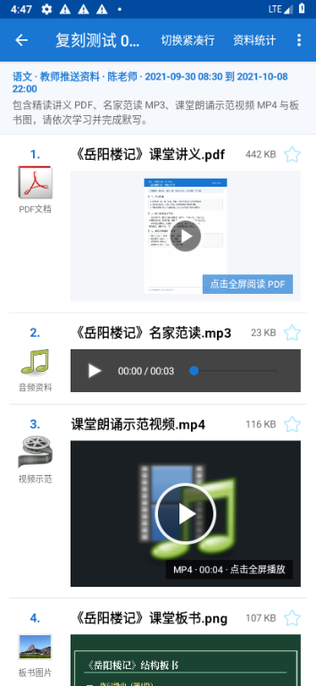 |
| 22 | 竖屏课程表（上下分栏） | 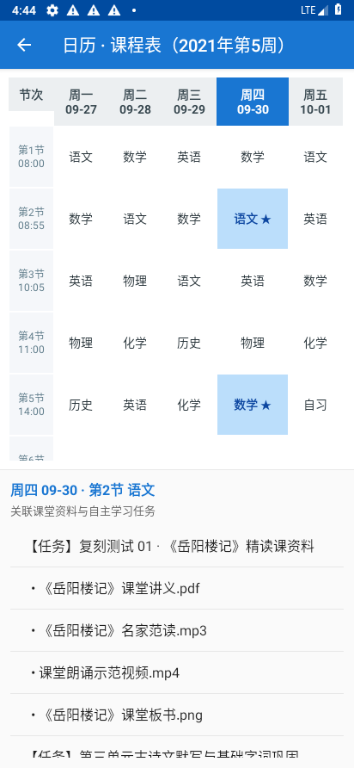 |
| 23 | 竖屏系统设置（GitHub 自动更新） | 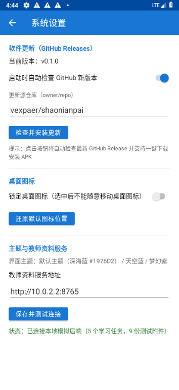 |

### 福昕风格全功能 PDF 批注阅读器基准截图（`v0.1.2`）

基于原版 APK 内嵌福昕模块（`com.foxit.uiextensions` + `uiextensions_config.json` + 原版 50+ 枚工具栏 PNG 图标与布局规范）结合 `PDFBox-Android` 深度复刻：
- **智能贴字文字标记**：高亮/强调、下划线、波浪线、删除线（自动吸附 PDF 文本行坐标并摘录原文，扫描件自动平滑回退）
- **完整绘画与注释工具**：铅笔手绘、直线、箭头、矩形、椭圆、橡皮擦、原版淡黄 `#FFFBD9` 便签批注与回复、打字写字、文本框、指向标注框（Callout）、教学印章（重点/必背/错题/疑问/已掌握/优秀）
- **属性栏与管理面板**：12 色调色板、1–12px 线宽滑块与预览、25%/50%/75%/100% 四档透明度、撤销/重做、连续标注模式、三标签侧边抽屉（批注列表 / 原生目录 / 书签）、全文关键词搜索、页面缩略图网格、日/夜护眼模式、亮度调节、加密 PDF 解锁及标准 PDF 批注导出分享。

| 序号 | 福昕风格 PDF 批注界面 | 对应原包布局 | 截图 |
| --- | --- | --- | --- |
| 24 | 第 1 页全批注实景 + 底部批注快捷栏 | `rd_main_frame.xml` | 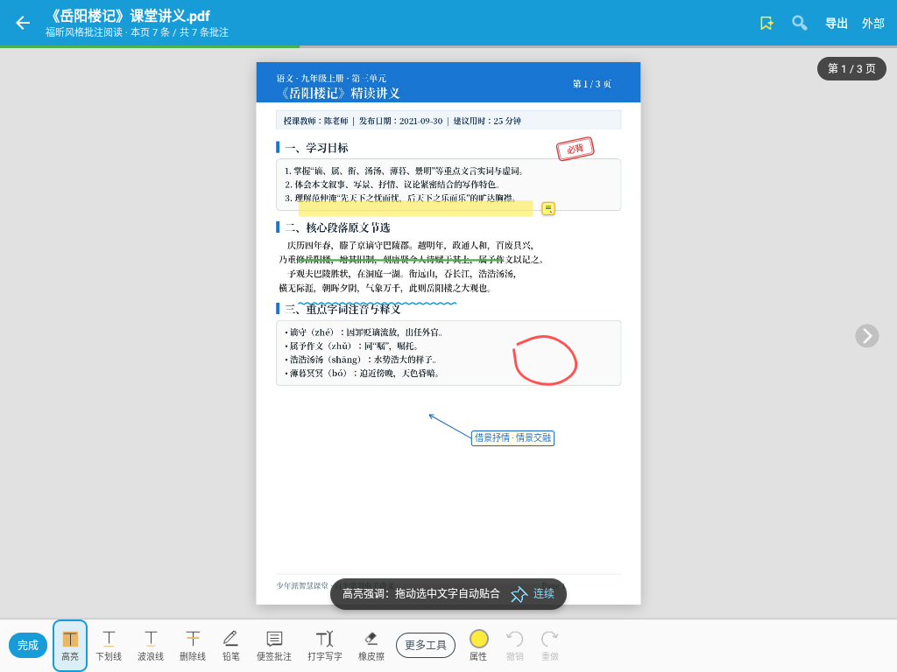 |
| 25 | 三分组「全部批注工具」抽屉 | `mt_moretools.xml` | 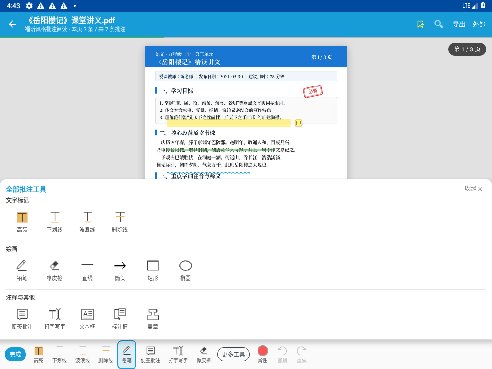 |
| 26 | 颜色 / 线宽 / 透明度属性栏 | `pb_rl_propertybar.xml` | 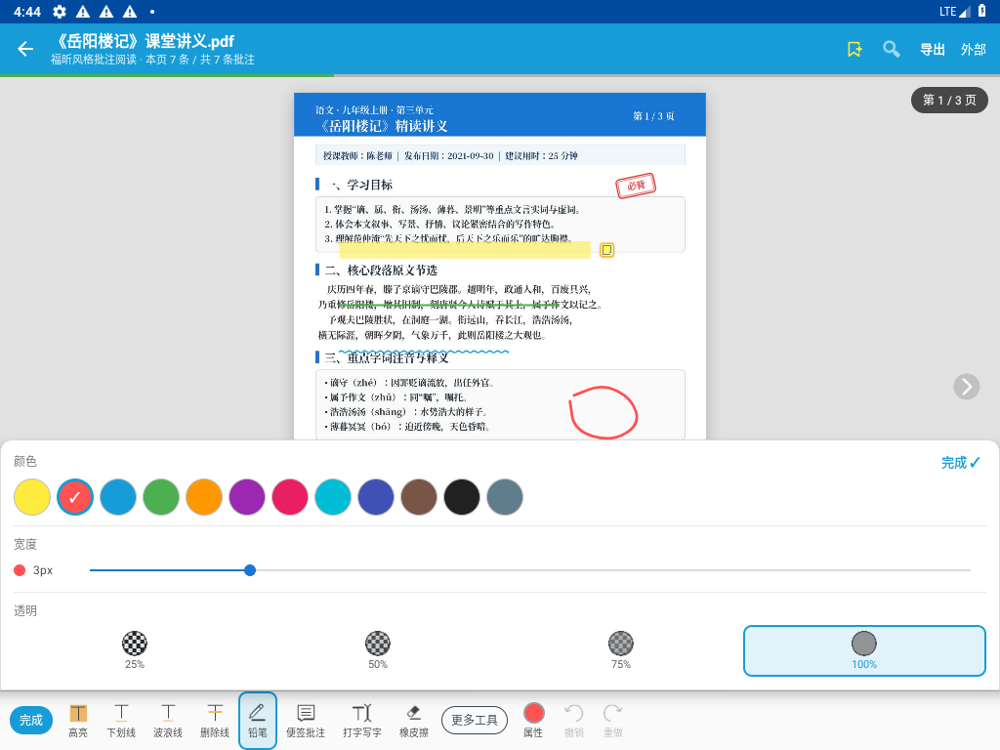 |
| 27 | 三标签侧边抽屉（批注 / 目录 / 书签） | `panel_annot_topbar.xml` + `panel_annot_content.xml` | 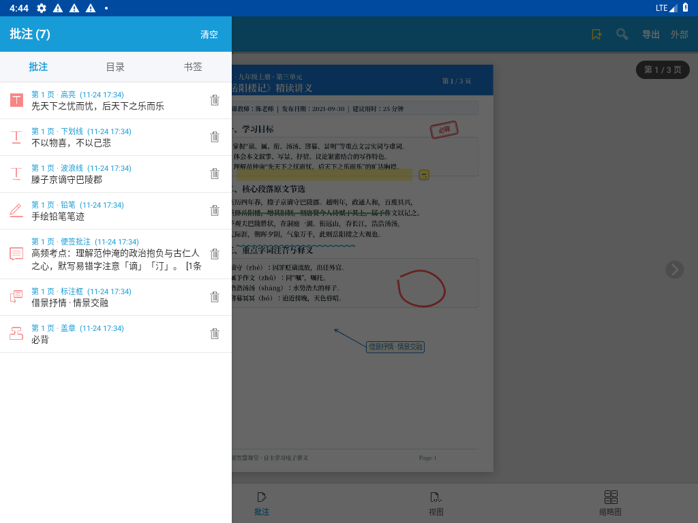 |
| 28 | 原版淡黄 `#FFFBD9` 便签批注与回复弹窗 | `rd_note_dialog_edit.xml` | 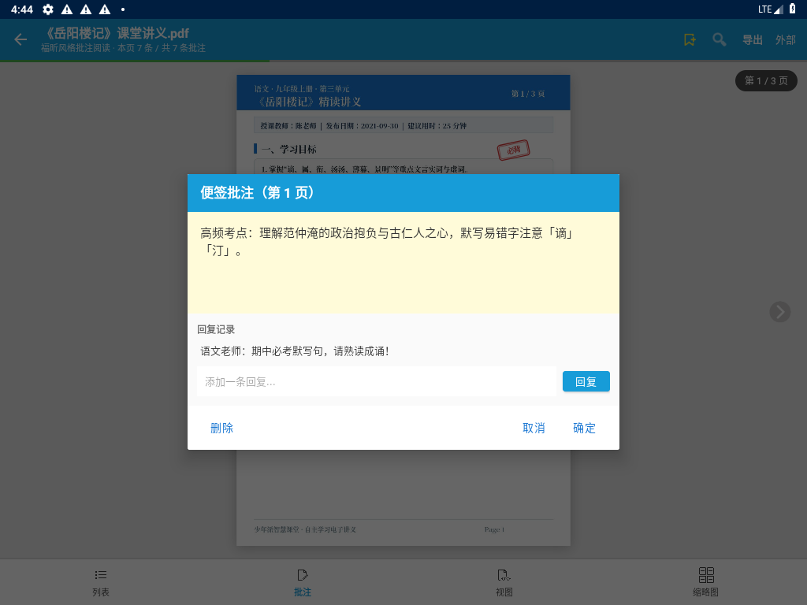 |
| 29 | 竖屏手机版福昕风格 PDF 批注 | `rd_main_frame.xml` | 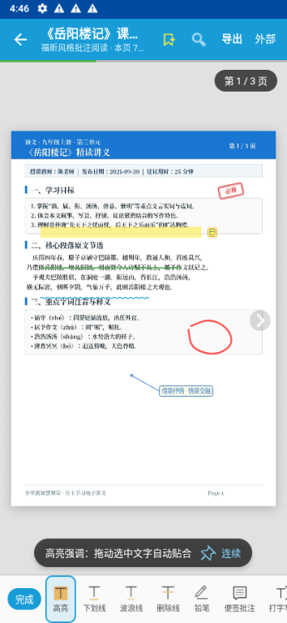 |

### 全局悬浮快捷条与多页草稿本基准截图（`v0.1.3`）

基于原版 `MyQuestionBookService`、`layout_questionbookbuttons.xml`、`background_screen_questionbook.xml` 与 `activity_fingerdraw.xml` 100% 复用原图素材复刻：
- **全局可拖动悬浮快捷条**：支持在任意学习页面拖动停靠（记住位置，可在设置页开关），点击主按钮展开 5 个高频工具：**收藏夹/试题本**、**当前页一键截屏收藏**、**相机拍照/相册选图收藏**、**多页草稿本**、**速记存入收藏夹**。
- **全功能多页草稿本**：铅笔、粗笔、文字输入、橡皮擦（长按清空本页）、8 色调色板、6 种原版纸张背景（默认米黄 / 横线 / 网格 / 点点 / 竖线 / 白纸）、多页新建翻页持久化，以及一键保存至「草稿本存档 / 我的收藏夹」。

| 序号 | 页面 | 对应原包布局 | 截图 |
| --- | --- | --- | --- |
| 30 | 书桌 + 全局悬浮快捷条展开（6 枚原版蓝框按钮） | `layout_questionbookbuttons.xml` |  |
| 31 | 全功能多页草稿本（横线纸 + 右侧竖向工具条） | `activity_fingerdraw.xml` | 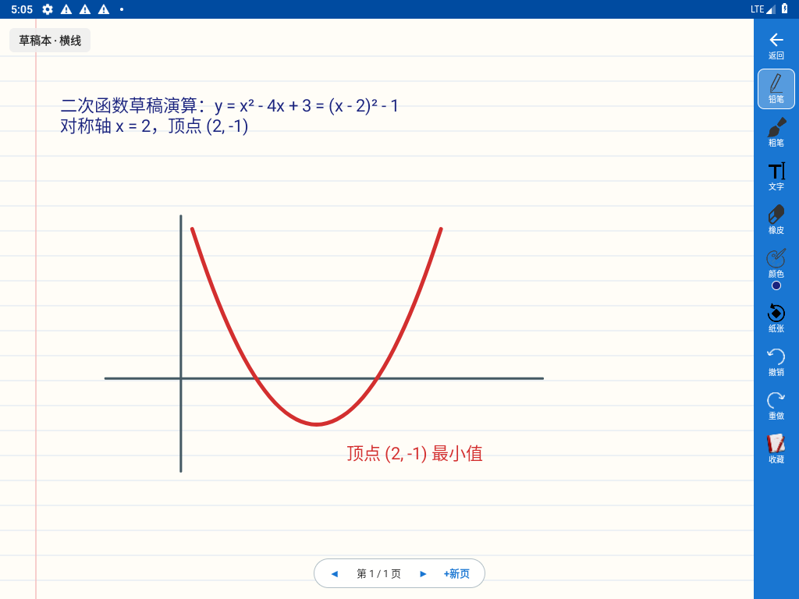 |
| 32 | 竖屏手机版悬浮快捷条展开 | `layout_questionbookbuttons.xml` |  |
